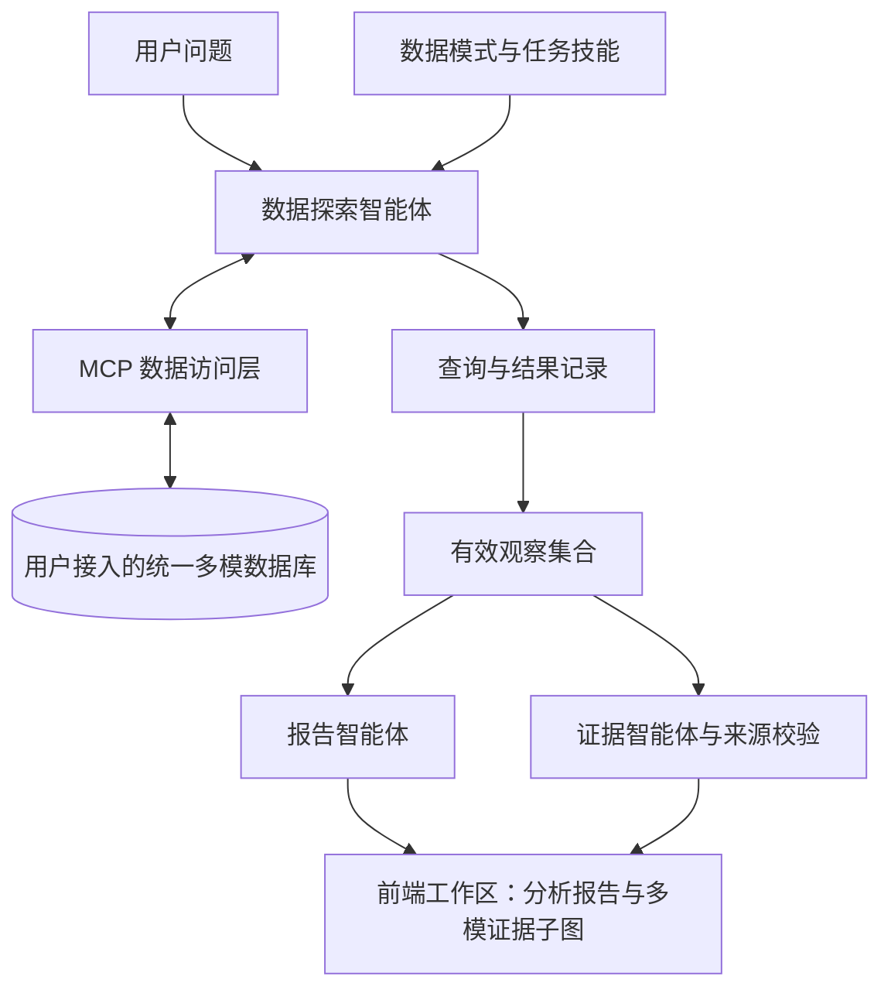

# BigDipper Scholar

**基于统一多模数据库的学术科技情报分析系统**

BigDipper Scholar 以支持复杂科研任务分析的多模数据管理作为研究问题，旨在贯通多模数据组织、跨模型统一查询与优化、智能体分析和多模证据生成，构建智能、高效、可追溯的科技文献分析系统，实现对海量科技文献中潜在知识关联、研究脉络与演化规律的系统化挖掘，为科研人员开展研究现状梳理、技术路线分析和研究方向识别提供有效支撑，提升科技情报分析的深度、效率与可解释性。本仓库提供论文《基于统一多模数据库的学术科技情报分析系统》的应用层实现，包括前端工作区、后端智能体、MCP 数据访问层、提示词和任务技能文档。

系统根据自然语言问题探索科技文献数据，生成分析报告，并以多模证据子图呈现支撑结论的论文、作者、机构、关系及检索来源。用户可以接入自己的文献数据库与模型服务，在工作区中提出研究问题、阅读报告，并查看证据的来源。

多模数据库和科技情报文献数据下载链接：
- **[统一多模数据库代码仓库](https://github.com/whu-totemdb/GredoDB.git)**
- **[科技情报文献数据](https://openalex.org)**

## 系统概览

- **数据探索**：通过 MCP 获取数据模式，按任务读取技能文档，执行查询，并根据结果调整后续探索。
- **报告生成**：从探索记录中选择有效结果，组织代表论文、研究方向、作者团队及统计分析。
- **多模证据**：从有效结果中提取实体、关系、文档、语义和统计证据，保留对应的查询与观察编号。
- **交互工作区**：展示报告、论文图谱和多模证据子图，支持查看节点与边的来源，以及保存、恢复历史结果。



这里的“多模”指关系、图、文档和向量等数据模型。例如，文献的标题和年份来自关系数据，摘要提供内容依据，引文和署名揭示实体间的关系，向量查询提供语义召回依据。系统保留这些结果及其来源，使用户能够追溯论文为什么进入分析、结论依赖哪些数据。

报告与证据使用同一组有效观察；证据生成阶段不再查询外部数据库。图谱只呈现实际结果支持的关系：由同一主题查询召回的两篇论文，不会自动被标记为彼此语义相似。详细定义见 [观察与证据协议](docs/evidence-contract.md)。

## 部署准备

| 组件 | 要求 |
| --- | --- |
| 后端环境 | Python 3.12+ |
| 前端环境 | Node.js 20.19+ 或 22.12+，npm |
| 语言模型 | 支持工具调用的 Chat Completions 兼容服务 |
| 数据源 | 自行部署的数据库；内置连接使用 PostgreSQL wire protocol，也可通过自定义 MCP 接入 |
| 语义检索（可选） | embedding 服务、与其模型和维度一致的语料向量，以及对应的查询配置 |

本仓库不包含数据库内核、文献数据和模型权重。数据库负责执行 SQL/MMSQL 及其支持的图、文档、向量运算；使用普通 PostgreSQL 时，可用能力取决于已安装的扩展和数据结构。

## 快速部署

以下命令在仓库根目录执行，适用于本机启动前后端。

### 1. 安装后端依赖

```bash
python3 -m venv .venv
source .venv/bin/activate
python -m pip install -r backend/requirements.lock.txt
python -m pip install --no-deps -e backend
cp backend/.env.example backend/.env
cp frontend/.env.example frontend/.env
```

### 2. 配置模型与数据库

编辑 `backend/.env`，填写自己的连接信息：

```dotenv
LLM_BASE_URL=
LLM_API_KEY=
LLM_MODEL=

DB_HOST=
DB_PORT=5432
DB_USER=
DB_PASSWORD=
DB_NAME=

BIGDIPPER_DATA_PROFILE=generic
BIGDIPPER_DB_SCHEMA=public
```

`LLM_BASE_URL` 应包含模型服务要求的 API 前缀，程序会追加 `/chat/completions`。数据库账号应具有目标数据的只读权限。默认 `generic` 模式读取实际数据模式，不要求表名使用 `cn_*` 前缀。

首次接入时，请按 [数据库接入](docs/data-integration.md) 配置实体字段映射；需要语义检索时，配置 embedding 服务及同一数据库中的向量表，也可提供自定义语义查询模板。使用自定义 MCP 的配置方式也见该文档。

### 3. 启动后端

```bash
cd backend
python -m app.preflight
python -m app.preflight --probe
uvicorn app.main:app --host 127.0.0.1 --port 8000
```

第一条检查必要配置，第二条通过 MCP 读取数据库模式。两项均成功后启动服务；这两项检查不验证模型推理和 embedding 请求能否成功。

### 4. 启动前端

在另一终端从仓库根目录执行：

```bash
cd frontend
npm ci
npm run dev -- --host 127.0.0.1 --port 5173
```

浏览器打开 `http://localhost:5173`。前端开发服务默认将 `/api` 请求转发到本机 `8000` 端口。

端口调整、静态构建、运行记录和常见配置问题见 [部署与运行](docs/deployment.md)。

## 开始使用

注册本地账号并创建 Agent 工作区后，可以根据已接入数据提出问题，例如：

> 分析武汉大学在 2015—2024 年期间的数据库研究进展，介绍代表论文、主要方向和作者团队。

> 查询某机构在指定年份区间内发表于 SIGMOD 和 PVLDB 的论文，分别统计篇数，并列出标题、作者与发表日期。

> 围绕一篇种子论文，结合引文关系和语义检索寻找相关工作，说明纳入每篇论文的依据。

这些问题分别需要相应的机构署名、venue、引文或向量数据；实际结果由数据覆盖范围和可用工具决定。只有标题与摘要时，系统据此组织分析。

报告生成后，点击 **Evidence Graph** 查看图谱，在“论文图谱”和“多模证据子图”之间切换。选择带有来源信息的节点或边，可以查看对应的观察编号、查询与返回字段。报告与图谱保存在工作区，刷新后可继续查看。

通用数据源的主要入口是 Agent 工作区。侧栏的手动论文搜索和部分人工扩展功能使用专用数据接口，使用前需要配置相应适配器，详见 [CN 适配说明](docs/data-integration.md#4-cn-适配)。

## 代码与文档

全部技能与各阶段提示词见 [技能与提示词索引](docs/prompts-and-skills.md)。三类任务技能和 MMSQL 教程分别对应论文中的任务分析技能与通用查询指导。

```text
backend/
  app/                  API、智能体流程、证据构建与工作区存储
  app/mcp_servers/      数据模式发现与查询工具
  prompts/              智能体提示词、技能文档与查询说明
  mcp_servers.yaml      默认 MCP 服务配置
frontend/src/           工作区、报告及交互图谱
docs/                   部署、数据接入与方法说明
examples/               配置和查询模板
```

| 文档 | 内容 |
| --- | --- |
| [部署与运行](docs/deployment.md) | 服务配置、端口、前端构建、数据保存与排查 |
| [数据库接入](docs/data-integration.md) | 通用数据源、字段映射、语义检索及自定义 MCP |
| [观察与证据协议](docs/evidence-contract.md) | 工具结果格式、实体关系、来源信息与证据校验 |
| [论文方法与代码](docs/method-alignment.md) | 论文方法在应用层的实现位置 |
